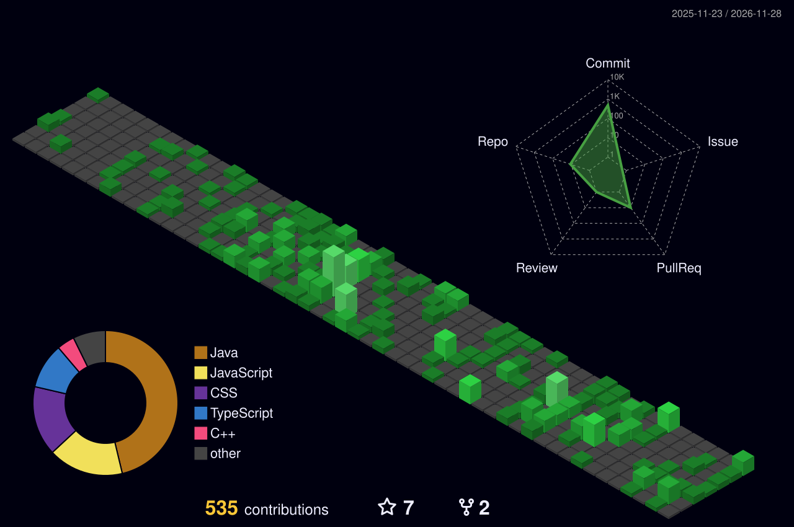

<div align="center">

<!-- HEADER -->


<!-- TYPING ANIMATION -->
[](https://git.io/typing-svg)

</div>

---

<!-- ABOUT -->
### `> who am I?`

```cpp
struct Wren
{
    String university  = "Bataan Peninsula State University";
    String degree      = "BS Computer Science (2025–2029)";
    String location     = "Philippines 🇵🇭";
    String interests[3]  = {"IoT", "Embedded Systems", "Software Development"};
    String currentlyWorkingOn = "Embedded systems roadmap: C++ → Arduino/ESP32 → connectivity";
    String motto        = "Not just how to build, but why things work.";
};
```

---

<!-- ACTIVITY GRAPH -->
<div>

### `> activity`

<div align="center">
    
</div>

---

<!-- STREAK + CONTRIBUTIONS (self-hosted via GitHub Actions — see /.github/workflows/readme-stats.yml) -->
<div>

### `> streak`

<div align="center">
    <a href="https://git.io/streak-stats"></a>
</div>


</div>

---

<!-- TECH STACK -->
### `> stack`

**Languages**


**Tools & Frameworks**


**Hardware & IoT**


---

<!-- PROJECTS -->
<h2 align="center">Projects</h2>

<table>
  <tr>
    <td align="center" width="50%" valign="top">
      <h3 align="center"><a href="https://github.com/WDCT-Wren/REPO-1">Krestel</a></h3>
      Non-invasive electricity monitor. An ESP32 reads the meter's pulse LED and serves a live usage and cost dashboard.<br/>
      <sub>ESP32 · C++ · JavaScript</sub>
      <br/><br/>
    </td>
    <td align="center" width="50%" valign="top">
      <h3 align="center"><a href="https://github.com/WDCT-Wren/REPO-2">EntroPass</a></h3>
      JavaFX desktop password manager with a local encrypted vault (AES-256-GCM, PBKDF2, BCrypt). Shipped v1.0.1.<br/>
      <sub>Java · JavaFX · SQLite</sub>
      <br/><br/>
    </td>
  </tr>
  <tr>
    <td align="center" width="50%" valign="top">
      <h3 align="center"><a href="https://github.com/WDCT-Wren/REPO-3">SeraphIV</a></h3>
      Arduino IV fluid monitor. A load cell tracks remaining volume and sends SMS alerts to the nurse at 30%, 15%, and 5%.<br/>
      <sub>Arduino Mega · HX711 · SIM900</sub>
      <br/><br/>
    </td>
    <td align="center" width="50%" valign="top">
      <h3 align="center"><a href="https://github.com/WDCT-Wren/REPO-4">CodeShare</a></h3>
      Real-time team chat that surfaces GitHub pushes, PRs, and commit diffs in the conversation. Built in 5 days.<br/>
      <sub>Node.js · Socket.io · PostgreSQL</sub>
      <br/><br/>
    </td>
  </tr>
</table>

</div>

---

<!-- CERTIFICATIONS -->
### `> certifications`

- 🏅 **IT Specialist — Java** · Pearson / Certiport · 2026
- 🏅 **IC3 Digital Literacy** · Certiport · 2026

---

<!-- CONNECT -->
### `> connect`

<div align="center">

[](https://linkedin.com/in/wren-daniel-tulio)
[](mailto:Wdctulio25@bpsu.edu.ph)

</div>

<!-- FOOTER -->

